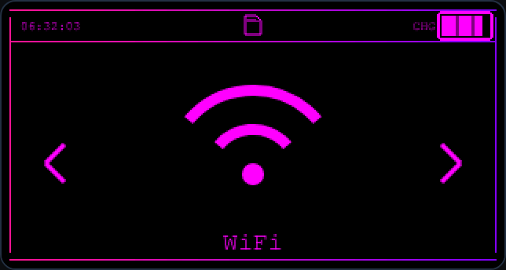
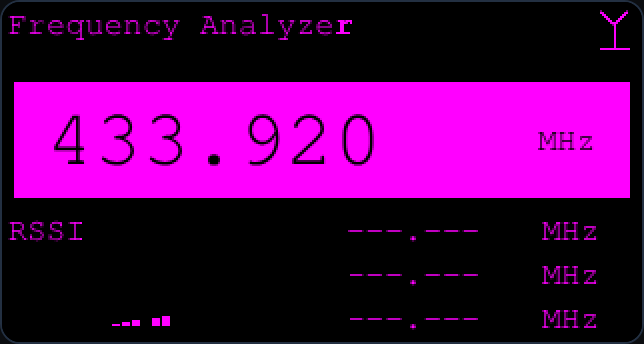
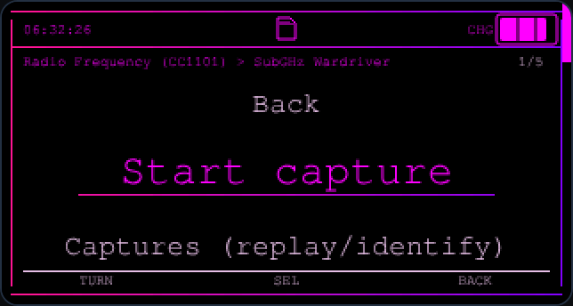
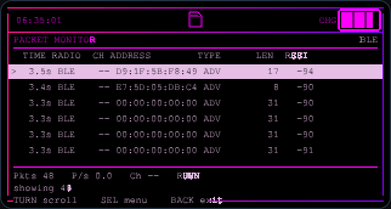
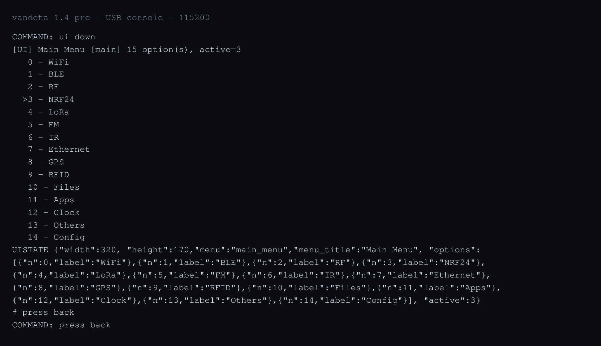
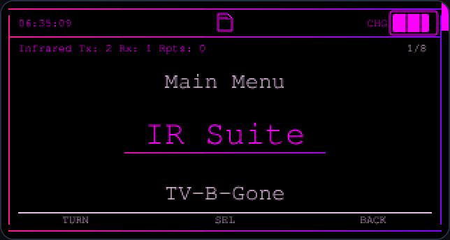

# Vandeta

**Bruce 1.16.1, retuned for the LilyGo T-Embed CC1101 Plus.**

<p align="center">
  
</p>

[](https://github.com/Axagt40/Vandeta/releases)
[](https://github.com/Axagt40/Vandeta/actions/workflows/PR_check.yml)
[](https://lilygo.cc/products/t-embed-cc1101)
[](https://github.com/BruceDevices/firmware)
[](LICENSE)
[](https://discord.gg/dhPXgVerqD)

[GIF: 3 s - Frequency Analyzer sweeping 433 MHz, then a Wardriver capture list]

The T-Embed puts the **CC1101 and the display on one SPI bus**, so a radio
transaction that lands while the screen is being written comes back as noise and
stock Bruce's scans, sweeps and captures drop out on this board. Vandeta takes
the bus for a whole radio operation (`rf_spi_lock()` plus the matching `TFT_eSPI`
`busLock()`), parks sweeps between hops and uses an adaptive noise floor, so the
analyzer, the wardriver, the capture layer and the nRF24 tap repeat.

> **[Install](https://axagt40.github.io/Vandeta/flash.html)** ·
> **[Download 1.4 pre](https://github.com/Axagt40/Vandeta/releases/tag/vandeta-1.4-pre)** ·
> **[What's new in 1.4](https://github.com/Axagt40/Vandeta/releases/tag/vandeta-1.4-pre)** ·
> **[Docs](https://axagt40.github.io/Vandeta/docs.html)** ·
> **[Discord](https://discord.gg/dhPXgVerqD)**

1.4 is a pre-release, and the flasher opens on **Official 1.3** - press
**Pre-release** to select it. The source for every build is published in this
repository, per release, from 1.4 onward.

Every screen below was captured from the board over USB, at 320 x 170.

|  |  |  |  |
|:--:|:--:|:--:|:--:|
| Main menu | Frequency Analyzer, 433.920 MHz | SubGHz Wardriver | Packet Monitor (BLE) |

|  |  |
|:--:|
| Console readback: `ui` prints the menu it is on | Infrared, with IR Suite on top |

[PHOTO: board with external antenna]

---

Vandeta is custom firmware for one board, the **LilyGo T-Embed CC1101**, built
on **[Bruce](https://github.com/BruceDevices/firmware) 1.16.1** — the
open-source ESP32 offensive-security firmware. It keeps Bruce's architecture,
menus and tools as its foundation and adds the tooling listed below on top of
them. Upstream credit and the AGPL-3.0 `LICENSE` are untouched, and the whole
upstream feature list still applies here (it is in
[`docs/UPSTREAM.md`](docs/UPSTREAM.md)).

> **All credit for the firmware belongs to the Bruce project and its
> contributors.** Vandeta would not exist without it.

---

## :sparkles: Why this exists

Vandeta's goal is to be the **only firmware you need for the T-Embed CC1101**:
everything Bruce does, plus a full **USB console** that can drive and inspect the
device from a PC — screens, menus, files, radios, memory and JavaScript — with no
WiFi, no reflash and no extra hardware.

---

## :computer: Vandeta feature list

Everything below is in Vandeta and **not** in stock Bruce. Bruce's own menus,
apps, radios and script ecosystem are unchanged and still present — this is the
extra layer on top of them.

<details>
<summary><b>USB console — Developer Options</b></summary>

* One `Developer Mode` switch (`Config > System Config > Developer Options`)
  arms the console and the speed profile together.
* `ui`, `ui watch`, `move up|down|left|right|nextpage`, `press ok|back` drive the
  menus and print the screen you land on, including pages that build a local
  option list (Config, System Config, WiFi, Bluetooth, Files, Others).
* A line editor with **Up/Down command history** (16 entries), Tab completion,
  Backspace and Ctrl-C/U/L, and command echo in **2-3 ms** — the console behaves
  like a shell, not a one-line pipe.
* `file read|write|list|delete|stat`, `log show|clear|on|off`, `errors`,
  `help <command>`.
* `usbdebug status|proto|on|off`, hot reload and live update rows in the menu,
  and a framed binary protocol for reliable transfers over the same cable.
* `livepatch apply <module> <code>` reloads the JavaScript layer without a
  reflash; `liveboot enable|disable|status` runs a script at boot.
* `display ring on|off` and `display dump` inspect what a screen actually drew.
* The error ring collects ESP-IDF, Arduino `log_x()` and plain `printf()` /
  NimBLE lines in one place.
* Commands answer as they run, and switching Developer Mode off releases the
  console's queues, watches and RX buffer so the firmware is as light as a stock
  build.

</details>

<details>
<summary><b>Sub-GHz / CC1101</b></summary>

* **Working CC1101 RF.** The radio shares the display's SPI bus, so Vandeta
  serializes every radio transaction against the display (`rf_spi_lock()`),
  parks sweeps between hops and uses an adaptive noise floor. Scans, reads,
  spectrum, the analyzer and the wardriver all run reliably.
* **Frequency Analyzer** — Flipper-style: coarse hop over the three CC1101
  bands, 20 kHz fine pass, big held frequency readout, last three hits, RSSI
  meter, and a log page with sort (`OK`) and scroll.
* **SubGHz Wardriver** — whole-burst capture (256 pulses, streamed straight to
  the card), duplicate window, 433/315/868/915 band hop, short-pulse noise
  rejection, a captures browser, verbatim replay and one-pass
  `Identify & save` to a `_dec.sub`.
* `subghz rx <seconds>` listens for a timed window; `subghz wardriver
  capture|list|identify|identifyall|replay|status|selftest` drives the wardriver
  from the console.
* Replay follows the signal's own length (up to 30 s), and an oversized capture
  is refused with a clear message.

</details>

<details>
<summary><b>nRF24 (2.4 GHz)</b></summary>

* **Raw Capture** (`NRF24 > Raw Capture`) receives in the
  **pseudo-promiscuous** configuration — CRC off, auto-ack off, the shortest
  address width and degenerate noise addresses on all six pipes — so a 2.4 GHz
  remote can be captured by address-agnostic listening.
* Capture 3 s on the current channel or **hop 0-125**, **RGB remote capture**
  with presets (MiLight RGBW, CCT, RGB+CCT, RGB, FUT020), set capture channel,
  frequency range, promiscuous on/off and data rate (1 Mbps / 2 Mbps /
  250 kbps).
* **Channel scan** (126 channels with an activity level), **Multi-freq detect**
  (dual-frequency remotes), **Frequency analysis**, capture list, save/load
  profiles, **Replay capture** and **Analyze packet** (length, unique bytes,
  bit transitions, byte range, repetition, code length, kind).
* Live progress screen with `Press BACK to stop`; only Back aborts.
* Console: `nrfcap` / `nrf`
  `info|init|promisc|channel|rate|power|freqrange|scan|capture|capch|lock|rgb|multifreq|profile|profiles|repeat|list|replay|save|load|analyze`.
* JavaScript: `nrf24.captureRaw`, `replayRaw`, channel scan, multi-frequency
  detection, signal analysis, save/load and the raw receive/send bindings.
* Capture buffers are allocated from PSRAM, keeping ≈36 KB of internal DRAM
  free for WiFi and BLE.

</details>

<details>
<summary><b>Packet Monitor</b></summary>

* One dashboard fed by **WiFi, BLE, nRF24 and Sub-GHz**, opened from each of
  those menus with its own radio preselected.
* Filters (radio, type, MAC-OUI, channel, text, only-new), counters per radio
  and per type, packets/sec, busiest channel, CSV export and PCAP export of the
  captured WiFi frames, pause, change source and clear.
* All four taps capture live on this board: WiFi, BLE, nRF24 and Sub-GHz.

</details>

<details>
<summary><b>BLE</b></summary>

* **BLE Detector** — live table of advertisers with Apple Continuity types
  decoded, distance estimate, paging, hold and clear.
* **Capture & Replay** with a live packet counter and Back-to-stop.
* JS GATT client (connect, services, characteristics, read/write/notify) and the
  capture/replay bindings, plus headless advertisement spam.
* BLE bring-up, teardown and the memory guard keep internal DRAM available, and
  a WiFi feature frees BLE memory first — so BLE tools start cleanly even after
  another radio has been used.

</details>

<details>
<summary><b>Infrared</b></summary>

* **Universal Remote** — the Flipper IR database's TV / AC / fans / audio /
  projectors / LEDs libraries (2,858 codes, shipped on the card under
  `/infrared/Universal/`), sweep-per-button with pause and cancel.
* **IR Suite** — `Infrared > IR Suite`, the Vandeta IR Suite 1.1. It is built
  into the firmware image, so the row works with no SD card and there is
  nothing to copy. One **Bruteforce remotes** row asks which kind of remote
  first — the same six types the Universal Remote offers (TV, AC, Fans, Audio,
  Projectors, LEDs) — and then offers three sweeps for that type: **brand**
  (each per-model `.ir` of one make), **remote** (every candidate code in the
  type's library) or **family** (one code per protocol+address family). It
  locks and slowly replays the last ten codes when the device reacts, saves the
  identified one as a `.ir` remote in `/BruceIR` (so IR > Custom IR lists it
  with the recorded remotes) with every button the library holds, and runs
  BadUSB-style `.txt` payloads (`UP`, `DELAY 300`, `OK`) against that remote.
  Also drives a saved remote as a keypad and mirrors an image/video to a DLNA
  or Cast TV. The same library is exposed to scripts (`ir.universalList`,
  `universalSend`, `universalFamily`, `ir.transmitButton`).
* **Brand AC remotes** for twelve makes, sending a full state frame (power,
  mode, 16–30 °C, fan).
* Hand-written encoders for RCA and NEC42, protocols the ESP32 IR library lacks.
* Button lists build in one pass, so a category opens immediately and the
  sweep's progress bar is sized before the first code is sent.
* TV-B-Gone and the universal sweep share one pause/cancel policy.
* `ir uni list|buttons|send`, `ir ac list|send`, `ir rx <seconds>`; GPI02 is
  claimed before use and the LED is switched off afterwards.

</details>

<details>
<summary><b>WiFi</b></summary>

* ARP spoofing, DNS spoofing and HTTP interception/modification that reach
  WPA2/WPA3 clients (the frames go out on the encrypted station link).
* **MITM Attack** runs a whole interception attack from the keypad: pick the
  network, the target (`All devices` or one host from the ARP scan) and one
  payload, then Start. The engine answers the target's TCP handshake itself, so
  a poisoned client reaches the payload's page with no other listener running.
  Back stops the attack and **restores every ARP mapping**, so a victim is never
  left cut off.
* **Plaintext HTTP on any port**, and **HTTPS on :443** through a built-in
  self-signed TLS endpoint, so an `https://` visit gets the same redirect or page
  after the browser's one-time certificate warning. QUIC is dropped and IPv6 /
  SVCB answers are suppressed, so a dual-stack or HTTP/3 client falls back to the
  intercepted path instead of bypassing it.
* A **live event feed** on the run screen — `+4s 192.168.1.107 redirected
  example.com`, `attack started against <network>`, real client and host names —
  instead of a counter table.
* The payload, `/BruceSpoof/mitm.txt`, is the JS MITM API in plain text — `page`
  (200 + HTML), `redirect` (302), `dns` (answer lookups), `target` and up to
  three chained `fallback` lines (e.g. DNS at 10 s, then a 302 at 25 s, each
  only while no request has been caught). A `.html` payload is just `page *`
  with that file; a page must fit one ethernet frame. `dns` answers accept
  `gateway` or `this`, resolved on each query, so a payload loads before the
  board has joined a network. A ready-to-use `/BruceSpoof/test.mitm` (page
  `html/test.html`) proves the whole path without any external site.
* Evil-twin captive portal that refuses with a readable error when DMA memory is
  short.
* Headless, deadline-bounded attacks so scripts can run them; `moreatk` verb,
  plus `mitm` (and the older `dnsinject` / `htmlint`) for the MITM engine.

</details>

<details>
<summary><b>BadUSB / HID</b></summary>

* `HID Settings` menu: USB footprint (VID, PID, manufacturer, product,
  serial), keyboard layout (extra layouts and custom import/export), HID device
  type, attack timing, payload manager, show output.
* Payloads keep typing past characters the active layout cannot express.
* `Apple/BLE Patch` and `BadBLE Name` in the same menu, so the BLE keyboard is
  listed by iOS and macOS and pairs Just Works.
* `badusb config|set|layout-import|layout-export|layout-copy|mouse|click`.

</details>

<details>
<summary><b>JavaScript API</b></summary>

* `arpSpoof`, `dnsSpoof` and `httpInterceptor` for the MITM engines.
* `wifi.injectPacket`, `sendRaw80211`, `captureStart`, `captureStop`,
  `getCapturedPackets`, `packetInfo`, `injectDns`, `injectHttp`,
  `injectHttpRedirect`, `injectHtml`, `portal`, `setPromiscuous`.
* BLE GATT client plus advertisement capture/replay and headless spam.
* `nrf24.captureRaw`, `replayRaw`, channel scan, multi-frequency detect, signal
  analysis, save/load, `receive`/`send` and the radio settings.
* `scriptFolder.create|list|load|run|close|isRunning|getAllScripts|stop|kill`,
  with `setShared`/`getShared` for passing state into a background job.
* `ir.transmitRaw`, `subghz.scan`, `storage.exists|size|copy`,
  `serial.available|read`.
* Bindings are pinned against the interpreter's moving GC, so scripts can build
  containers safely.

</details>

<details>
<summary><b>Files, storage and settings</b></summary>

* `md5`, `crc32`, `cat` and `storage read` stream in 512-byte chunks — any file
  size, with a flat 512-byte buffer.
* `file read|write|list|delete|stat` with paths resolved against the console's
  working directory.
* Persisted settings in `bruce.conf`: the Developer Mode switch, the protocol
  preference, the whole BadUSB footprint and the Wardriver frequency, duplicate
  window, minimum pulse count and band hop — all validated on load, so a
  hand-edited or truncated config cannot break a boot.

</details>

<details>
<summary><b>Menus and navigation</b></summary>

* Breadcrumb path (`WiFi > Wifi Atks > Target Atks`), `n/total` counter and a
  scrollbar on long lists, plus an encoder hint bar (`TURN` / `SEL` / `BACK`).
* Capture screens show live progress and `Press BACK to stop`; only Back aborts,
  and presses queued during a capture are dropped before the result screen.
* `ui` / `nav` report the menu that is on screen, so a host can mirror and drive
  the device blind.

</details>

<details>
<summary><b>Board support and memory</b></summary>

* The CC1101 and the display share one SPI bus; a `TFT_eSPI` bus lock
  (`busLock()` / `busUnlock()`) lets the RF layer take the bus for a whole radio
  operation.
* nRF24 capture buffers are allocated from PSRAM, keeping ≈36 KB of internal
  DRAM free for the radios.
* `RFID > Read 125kHz` is wired to the UART pins (`RFID125_RX/TX`); the Plus has
  no 125 kHz antenna of its own, so it needs an RDM6300-class module on them.
* The WiFi tap brings the radio up directly and releases the driver when it
  closes.
* Starting a WiFi feature first frees BLE, the web UI and stale captures, and
  the BLE guard checks the full ~56 KB a bring-up needs.

</details>

<details>
<summary><b>Diagnostics and reliability</b></summary>

* Radio bring-up is memory-guarded: WiFi, BLE and the CC1101/nRF24 taps check
  the internal DRAM and DMA they need, release the other radio first, and fail
  with a readable message instead of a reboot.
* Long files hash, print and copy in bounded chunks, so a large file cannot
  exhaust the heap or wedge the console.
* Screen mirroring is safe to start/stop repeatedly, and `display dump` copies
  its log on the heap so a long dump cannot overflow a stack buffer.
* `i2c scan`, `proc`, `mem` and `sys` answer in one line per item, which makes
  them usable from a script.

</details>

<details>
<summary><b>Build and release</b></summary>

* The source is published in this repository, under **AGPL-3.0** — the same
  licence as upstream Bruce. `main` is the build tree, laid out the way
  upstream is: `src/`, `boards/`, `lib/`, `sd_files/` and `platformio.ini` at
  the root, with the flasher site in `site/`. Everything the image is built
  from is here, and the source is published with each release from 1.4 onward.
* Every released image is one merged file &mdash; bootloader + partition table
  + app &mdash; written at `0x0` and checked against its published SHA-256.
* The universal IR libraries ship in the 1.3 SD pack and on the card under
  `/infrared/Universal/`.
* Firmware internals keep Bruce's names — `/BruceJS`, the `bruce` verbs, the
  BruceNet AP — with AGPL-3.0 and upstream credit unchanged.

</details>

---

## :electric_plug: Hardware

| | |
|---|---|
| Board | **LilyGo T-Embed CC1101 Plus** |
| MCU | ESP32-S3, 16 MB flash, 8 MB PSRAM |
| Display | 320x170 landscape, encoder navigation |
| Radios | CC1101 Sub-GHz, nRF24 socket, WiFi, BLE |
| Notes | Runs on battery; the CC1101 and nRF24 are not simultaneous |

---

## :building_construction: Installing

**Fastest: the [browser flasher](https://axagt40.github.io/Vandeta/flash.html).**
Plug the board into a computer running Chrome or Edge, open that page and press
**Install**. It reads the newest release from GitHub, checks the image against
the release's SHA-256 and writes it at `0x0` — nothing to install on the
computer.

Or do it by hand: the image is **pre-merged** (bootloader + partition table +
app), so it is one `write_flash` at offset **`0x0`**. Download it from the
[latest release](https://github.com/Axagt40/Vandeta/releases/latest) —
`vandeta.bin` — together with `vandeta.bin.sha256`.

```sh
# 1. verify the download
sha256sum -c vandeta.bin.sha256

# 2. flash it (board in console mode: lsusb shows 303a:1001)
# keep 115200: a 921600 write stopped part-way on this board during testing
esptool.py --chip esp32s3 --port /dev/ttyACM0 --baud 115200 \
    write_flash 0x0 vandeta.bin
```

* **Wrong offset bricks the boot** — the merged image always goes to `0x0`.
* Windows: replace the port with `COM5` (or whatever Device Manager shows).
* No `/dev/ttyACM0` on Linux, but `lsusb` shows `303a:1001`? The `cdc_acm`
  driver is not loaded: `sudo modprobe cdc_acm`.
* `303a:0002` instead of `303a:1001` means the board is in USB Mass Storage mode.
  Leave it on the device before flashing.
* Clean install (wipes saved settings): `esptool.py ... erase_flash` first.
* Flashing this image does **not** touch the SD card.

The boot screen is drawn in your UI colour (Settings → Display & UI → UI Colour),
so it matches the rest of the theme.

---

## :keyboard: Using it from a PC

Turn on **Config → System Config → Developer Options**, then talk to the board
over the same USB cable:

```sh
# what is on the screen right now
ui
# press a key and read the screen you land on
ui down
ui select
# card and system
ls /                   storage free sd        mem        sys
file read /bruce.conf  md5 /bruce.conf         errors     proc
# script layer, live
js run /BruceJS/yourscript.js
livepatch apply hello console.log('hi')
# application-layer interception, headlessly
dnsinject status && htmlint status
```

The console boots in plain text and only switches modes when asked, so a
mis-typed command can never leave the board in an unusable state.

---

## :hammer_and_wrench: Building from source

`pio run -e lilygo-t-embed-cc1101`, PlatformIO Core 6.1.19+, and the merged
image goes to the board at `0x0`. Toolchain versions, the merge step and the
flash command are in [`BUILD.md`](BUILD.md).

## :speech_balloon: Community

Questions, builds and feedback: **Discord** — <https://discord.gg/dhPXgVerqD>

---

## :white_check_mark: Verified on the board

The 1.4-pre image (`nogit-20261112-134113`) reports `vandeta 1.4-pre` in `info`.
On it, `t50_ble_attacks.py` scored **22 passed / 0 failed / 0 skipped**,
`t45_patch_overlay.py` **35 passed / 0 failed / 1 declared skip** and
`t48_tasks.py` **21 passed / 0 failed**. The MITM transport barrier was measured
on the 2026-11-08 build, whose engine code is unchanged: a DNS-only payload arms
it, AAAA/SVCB/HTTPS come back empty, UDP/443 is answered with ICMP, TCP/853 never
opens, and a poisoned victim was back online 6 s after `mitm stop`
(`t46_mitm_fallback_live.py` 19/0/1, `t45_mitm_phone_live.py` 24/0/0).

---

## :warning: What this build does not do

* A DHCPv6-provided resolver is not retired; its IPv6 data path is blocked.
* The DoH reset needs the TLS SNI, so ECH and DoH-by-IP stay invisible.
* Android Private DNS in strict mode shows a notification when 853 is blocked.
* The HTTPS endpoint is self-signed, so a strict client warns.
* A randomised MAC breaks a single-target ARP pair, and the takeover wants a
  warm ARP entry, so the first run after a reboot can miss.
* Resolver answers are pinned for 300 s, so a client can keep the board's answer
  for up to five minutes after `mitm stop`.
* The BLE MITM relay proxy is not implemented; PEAP stays the passive subset.
* The CC1101 and the nRF24 cannot demodulate 802.11 - there is no client list,
  probe or deauth from either one.
* This board has no microphone, so `modem recv` says so instead of pretending.

---

## :clap: Credits and licence

* **Bruce** — <https://github.com/BruceDevices/firmware> (upstream:
  <https://github.com/pr3y/Bruce>). Vandeta is built on Bruce 1.16.1; the
  firmware is Bruce's work, and the upstream feature list, device support and
  documentation in `docs/UPSTREAM.md` are its authors'.
* Licence: **AGPL-3.0** (`LICENSE`), third-party notices in `THIRD_PARTY.md`.
* **Vandeta™** is an unregistered trademark of the project - the name and
  crown artwork are not covered by the code licence (`TRADEMARK.md`).

## :handshake: Attribution

If you use Vandeta in another project, credit it in your README:

> Based on Vandeta™ by Axagt40 - <https://github.com/Axagt40/Vandeta>

That line is a **request**, not an extra licence condition (`ATTRIBUTION.md`);
`TRADEMARK.md` covers the name and the crown.

---

## :bookmark_tabs: About the upstream project

* **Upstream:** [Bruce](https://github.com/BruceDevices/firmware) (originally
  [pr3y/Bruce](https://github.com/pr3y/Bruce)), AGPL-3.0.
* **What Vandeta keeps:** every Bruce menu, app, radio and script API - nothing
  was removed.
* **What Vandeta changes:** the CC1101 bus lock, the USB console, the IR Suite
  and the nRF24 capture layer - [`docs/DIFFERENCES.md`](docs/DIFFERENCES.md).
* **What stays upstream:** Bruce's full feature list, the 18-row device table,
  its acknowledgements and its disclaimer are kept verbatim in
  [`docs/UPSTREAM.md`](docs/UPSTREAM.md).
* **Credit:** the firmware is Bruce's work and its authors'; Vandeta is the layer
  on top.

---

If this is useful on your bench, a star on the repository helps other people
find it.
